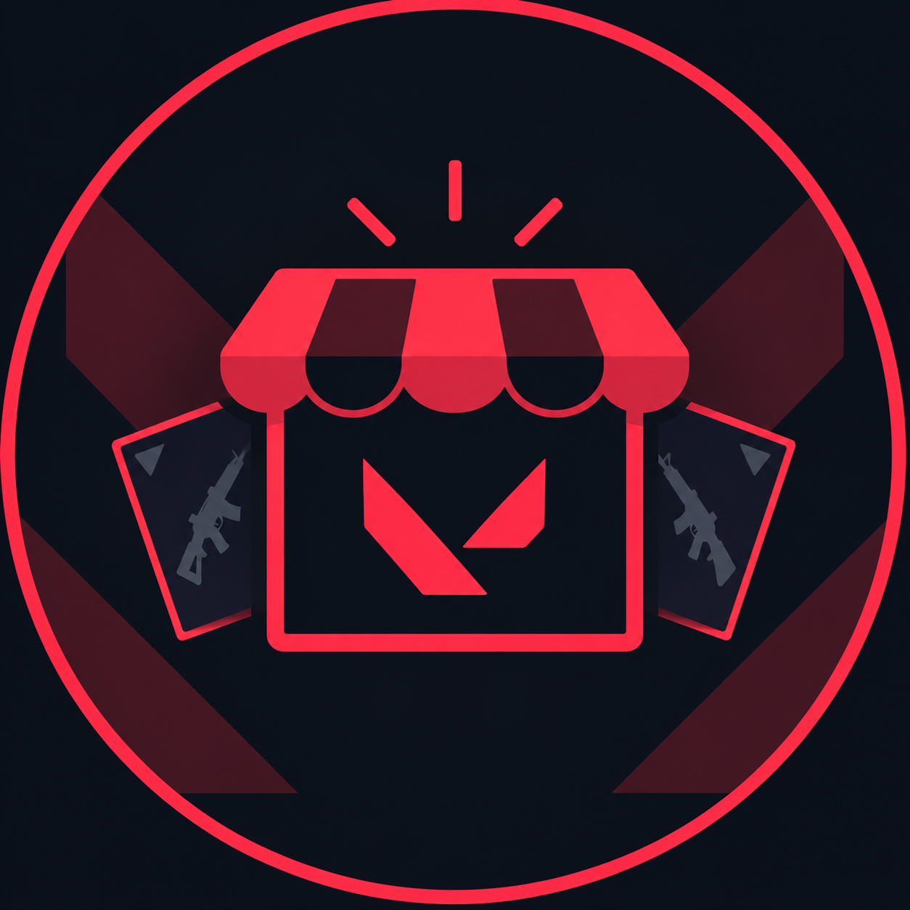

<div align="center">



# valorant shop

**See your VALORANT shop on the web and in Discord. Get pinged when a skin you want shows up.**

[Live site](https://xhv.sh/valorant-shop) · [How it works and the risks](website/legal.html) · [Report a bug](https://github.com/xhvsh/valorant-shop/issues)


</div>

> **Unofficial.** valorant shop is a fan-made project. It is not affiliated with, endorsed by, or supported by Riot Games, Inc. It uses undocumented player-data endpoints that Riot can change or block at any time. Read the [disclaimer](website/legal.html) before you run it or link an account.

## Features

**Website**

- Daily weapon skin shop, accessory shop, Night Market and featured bundles, with the same card layout everywhere.
- Wishlist of skins, with a Discord DM when one of them appears in your shop.
- Several Riot accounts per Discord login, plus a main account.
- Read-only sharing: give a friend a code and they can view one account's shop without ever seeing your tokens.
- Per-account tabs for the daily shop, accessories, Night Market, collection, alerts and sharing, plus competitive rank and wallet balances.
- **Delete all my data** in Settings wipes every account, token, setting and share code in one step.
- Clean URLs (`/wishlist`, `/bundles`, `/a/<puuid>`), no analytics and no third-party scripts.

**Discord bot** (slash commands, rendered as image cards)

| Command | What it does |
| --- | --- |
| `/shop` | Your daily shop, with the countdown to the next reset |
| `/accessories` | The accessory shop. Animated sprays are sent as GIFs |
| `/nightmarket` | Your Night Market with discounts, when it is live |
| `/bundle` | Featured bundles with prices and time left. No account needed |
| `/rank` | Competitive rank card |
| `/collection` | How many skins and accessories you own |
| `/share code`, `/share import`, `/share stop` | Share an account read-only, or open one shared with you |
| `/main` | Pick the account commands use by default |
| `/link` | Jump to the website to manage accounts and alerts |

Scheduled jobs send a daily shop DM right after the 00:00 UTC rotation and alert you when a new bundle appears.

## How it works

```
Browser / Discord
        |
   api/index.js  (Vercel)   or   server.js  (local)
        |
      app.js            routes, OAuth, sessions, cron endpoints
        |
   src/shop.js          fetch, cache and token refresh per account
     |        |
 src/riot.js  src/storage.js     Riot client       Supabase or in-memory
     |
 src/parse.js  ->  src/grid.js  ->  src/discord/embeds.js
   normalise         PNG / GIF          Discord message payloads
```

- **Sign-in happens on Riot's own page.** The site builds an OAuth 2.0 authorization code link with PKCE and a DPoP key (RFC 9449). You enter your password and 2FA on `auth.riotgames.com`, then paste the resulting redirect URL back so the server can exchange the code. Your password never reaches this app.
- **Tokens are encrypted at rest** with AES-256-GCM. Refresh tokens rotate, so a cross-instance lock in the database stops two serverless instances from refreshing the same account at once.
- **Images are rendered server side.** Skin grids, bundles, rank and collection cards are drawn as SVG and rasterised with `@resvg/resvg-js`. Animated sprays are re-encoded to GIF with `omggif` and `gifenc`.
- **Discord uses HTTP interactions**, so there is no long-running gateway process. Replies are Components V2 messages, sent with a deferred follow-up for the slow image work.
- **Scheduling.** Vercel cron covers the daily refresh. The cron routes also accept an exact-time external scheduler (such as cron-job.org), which is what the daily DM job uses so it fires at the rotation instead of a few minutes after.

More detail on every module is in [`.brain/`](.brain/index.md).

## Run it locally

Requires Node 20 or newer.

```bash
git clone https://github.com/xhvsh/valorant-shop.git
cd valorant-shop
npm install
cp .env.example .env
npm run dev
```

The app refuses to boot without `SESSION_SECRET` and `LINK_SECRET`. `ENCRYPTION_KEY` must be 64 hex characters. Generate any of them with:

```bash
node -e "console.log(require('crypto').randomBytes(32).toString('hex'))"
```

Without Supabase credentials everything is kept in memory, which is fine for development but is lost on restart. Discord sign-in and the bot need the Discord variables below.

## Configuration

Every setting is documented in [`.env.example`](.env.example). The ones you need:

| Variable | Purpose |
| --- | --- |
| `BASE_URL` | Public URL of the site, used for OAuth redirects and links |
| `BASE_PATH` | Set when mounted under a subpath, for example `/valorant-shop` |
| `SESSION_SECRET`, `LINK_SECRET` | Long random strings, required to boot |
| `ENCRYPTION_KEY` | 64 hex characters. Changing it forces every user to re-link |
| `SUPABASE_URL`, `SUPABASE_SERVICE_ROLE_KEY` | Persistent storage |
| `DISCORD_CLIENT_ID`, `DISCORD_CLIENT_SECRET`, `DISCORD_PUBLIC_KEY`, `DISCORD_BOT_TOKEN` | Discord login and the bot |
| `BUNDLE_SOURCE_ID` | Linked Discord user whose Riot account supplies `/bundle` data for everyone |
| `CRON_SECRET`, `SCHEDULER_SECRET` | Protect `/api/cron/*` |
| `ADMIN_DISCORD_ID`, `LOG_CHANNEL_ID` | Optional failure pings and a private log channel |

## Database

Create a Supabase project and run [`schema.sql`](schema.sql) in the SQL editor. It is safe to run again. Row level security is on and only the service role key, used server side, has access. Never expose that key to the browser.

## Discord bot setup

1. Create an application in the Discord developer portal and set the interactions endpoint URL to `<your site>/api/interactions`.
2. Fill in the four Discord variables.
3. Register the slash commands:

   ```bash
   node scripts/register-commands.js
   ```

   This registers them globally and clears any server-only copies, which would otherwise show every command twice. To audit what is registered:

   ```bash
   npm run check:commands
   ```

## Deploy

The project is set up for Vercel. `vercel.json` routes everything to `api/index.js` and defines the cron jobs.

```bash
npm i -g vercel
vercel deploy --prod
```

Set the same environment variables in the Vercel project settings. If you want the daily DM to go out exactly at the rotation, point an external scheduler at `/api/cron/dailyshop` with the `x-scheduler-secret` header.

## Project layout

```
api/            Vercel entry point
app.js          Express app: website routes, auth, API, interactions, cron
server.js       Local server
src/
  riot.js       Riot auth (PKCE, DPoP) and player-data requests
  shop.js       Per-account fetch, cache and token refresh
  parse.js      Raw Riot responses to clean store objects
  items.js      Item catalog from valorant-api.com
  grid.js       PNG and GIF rendering for Discord
  storage.js    Supabase storage with an in-memory fallback
  session.js    Login sessions
  discord/      Slash commands, message builders, signature check, logging
website/        Static dashboard (plain HTML, CSS and JavaScript, no build step)
scripts/        Command registration and audit, plus a few dev probes
schema.sql      Database schema
.brain/         Architecture notes for each module
```

## Security

- Riot refresh tokens are encrypted with AES-256-GCM before they are stored. Losing `ENCRYPTION_KEY` means every user has to re-link.
- Passwords are entered on Riot's own sign-in page and never reach this app.
- Share codes are stored only as HMAC digests.
- Sessions use an `httpOnly` cookie, and the site ships a strict Content Security Policy (`script-src 'self'`).
- Never commit `.env` files. They are ignored by `.gitignore`.

Found a vulnerability? Please message **@xhvsh** on Discord instead of opening a public issue.

## Contributing

Issues and pull requests are welcome. Keep changes small and run `npm run lint` before you submit.

This project only reads data that belongs to the signed-in user. Changes that buy items, automate gameplay, touch the game client, hit Riot at high volume, or access accounts that are not the user's own will not be accepted. They are also much more likely to be treated as a rules violation by Riot.

## License

[MIT](LICENSE). VALORANT and Riot Games are trademarks or registered trademarks of Riot Games, Inc.
